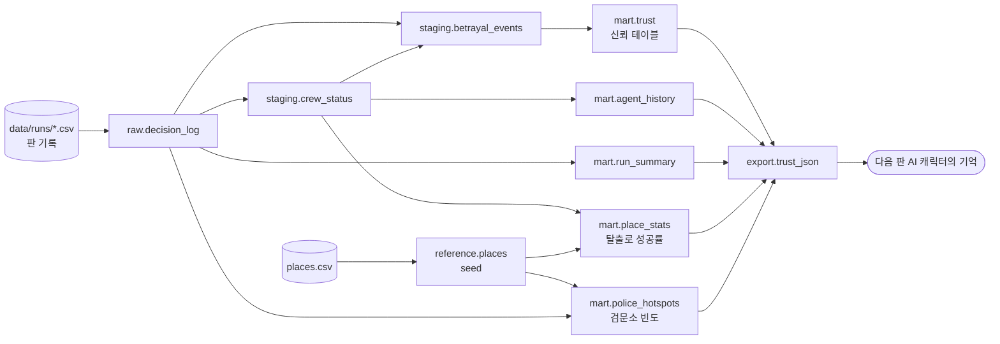

# Transamerica Job

단순한 도형으로 만든 로우폴리 3D 샌프란시스코 지도 위에서 **AI 캐릭터 4명이 은행을 털 계획을 세우고, 각자 스스로 결정하는** 이야기 게임이에요.
판이 끝날 때마다 "누가 누구를 배신했는지"가 기록되고, 다음 판의 캐릭터들은 그 기억을 가지고 시작해요.


## 등장인물

| | 이름 | 역할 | 성격 |
|---|---|---|---|
|  | **Ruby** | 리더 | 침착한 계획가. 팀원 보호가 최우선 |
|  | **Sky** | 운전수 | 겁이 많지만 샌프란시스코의 모든 길을 앎 |
|  | **Sunny** | 해커 | 돈만 중요. 계속 몫을 더 달라고 함 |
|  | **Mint** | 잠입 담당 | **몰래 경찰 정보원**. 본인만 알고 있음 |

## 무엇을 하나요

- **3D 지도:** 금문교, 베이 브리지, 트랜스아메리카 피라미드, 롬바드 스트리트, 피셔맨스 워프, 알카트라즈, 미션 디스트릭트 (Three.js)
- **AI 캐릭터:** 최대 10장면 동안 각자 할 말, 행동, 이동할 장소, 탈출 경로, 원하는 몫을 직접 정해요. 내레이터 AI가 주사위를 굴려 결과를 정해요.
- **매번 다른 결말:** 판마다 숨은 반전, 무작위 사건(안개, 교통 체증, 헬기 등), 주사위, 이전 결말 기억
- **말풍선과 목소리:** 캐릭터마다 다른 목소리로 대사를 읽어요
- **컷신:** 체포, 탈출, 배신, 은행 털기 순간에 그림이 떠요 (Runware로 미리 생성)
- **결정 기록:** 누가 무엇을 왜 결정했는지 기록하고 CSV로 저장해요
- **신뢰 기억과 학습:** Bruin 파이프라인이 지난 판 기록을 DuckDB에 모아 신뢰 테이블과 탈출로 성공률을 만들고, 캐릭터들은 그걸 기억으로 받아서 결정을 바꿔요

## 어떻게 동작하나요

AI 기능은 claude.ai 페이지에서만 동작하고, 그림 생성과 기억 정리는 내 컴퓨터에서 해요.

1. claude.ai 페이지에서 플레이해요
2. 기록을 CSV로 저장해요
3. `update-trust.ps1`을 실행해요 (Bruin: CSV → DuckDB → 신뢰 테이블 → `trust.json`)
4. 페이지에서 **Load trust.json**을 누르면, 다음 판 캐릭터들이 그 기억을 가지고 1번부터 다시 시작해요

- **claude.ai에서:** 플레이하는 사람의 Claude 계정으로 AI 캐릭터, 목소리, 파일 저장이 동작해요. API 키가 필요 없어요.
- **내 컴퓨터에서:** Runware 그림 생성(`.env`의 키 사용)과 Bruin 파이프라인을 실행해요.
- `index.html`을 내 컴퓨터에서 열면 AI 없이 무작위로 움직이는 **데모 모드**로 돌아가요.

## 준비물

| 필요한 것 | 용도 | 설치 |
|---|---|---|
| [Node.js](https://nodejs.org) | 미리보기 서버, 그림 생성 | 공식 사이트에서 설치 |
| [Bruin CLI](https://getbruin.com/docs) | 신뢰 테이블 파이프라인 | Git Bash에서 `curl -LsSf https://getbruin.com/install/cli \| sh` |
| Runware API 키 | 그림을 새로 만들 때만 | `.env` 파일에 넣기 (아래 참고) |

### 저장소에 없는 파일 2개 (직접 만들어야 해요)

비밀 정보나 내 컴퓨터 설정이라서 git에 올리지 않았어요.

**`.env`**: 그림을 새로 만들 때만 필요해요. 이 파일은 절대 공유하거나 올리지 마세요.
```
RUNWARE_API_KEY=여기에-키
```

**`.bruin.yml`**: Bruin 파이프라인을 돌릴 때 필요해요.
```yaml
default_environment: default
environments:
  default:
    connections:
      duckdb:
        - name: "heist-duckdb"
          path: "data/heist.duckdb"
```

## 사용법

### 내 컴퓨터에서 미리 보기 (데모 모드)
```powershell
node scripts/serve.mjs
```
브라우저에서 http://localhost:8124 를 열어요. 여기서 끝까지 돌린 데모 판은 `data/demo-runs/`에 따로 저장돼서, 진짜 기억에는 섞이지 않아요.

### 한 판 끝난 뒤 기억 업데이트하기
1. claude.ai 페이지에서 **Save log as CSV**를 눌러요. 다운로드 폴더에 저장돼요.
2. 이 폴더에서 PowerShell로 실행해요:
   ```powershell
   powershell -ExecutionPolicy Bypass -File .\update-trust.ps1
   ```
   다운로드 폴더의 기록을 `data/runs/`로 옮기고, Bruin 파이프라인을 돌리고, 신뢰 표를 보여줘요.
3. 페이지 왼쪽 **Trust from past runs** 옆의 **Load trust.json**을 눌러 이 폴더의 `trust.json`을 골라요.

### 그림 다시 만들기 (Runware)
```powershell
node scripts/generate-images.mjs                     # 없는 그림만 만들기
node scripts/generate-images.mjs --test              # Ruby 초상화 1장으로 키 확인
node scripts/generate-images.mjs --only=arrest_sky   # 한 장만 다시
node scripts/generate-images.mjs --redo              # 전부 다시 (비용 발생)
```

## Bruin 파이프라인: 캐릭터의 기억과 학습

`pipelines/trust`는 판 기록을 캐릭터들이 다음 판에 쓸 **기억과 지식**으로 바꿔요. 10개 자산(asset)을 Bruin이 의존 순서대로 실행하고, 데이터는 DuckDB에 쌓여요.



| 결과 | 캐릭터가 받는 기억 |
|---|---|
| `mart.trust` | 모두: "Mint에 대한 신뢰 22/100 (경찰 정보원으로 들통남 1번)" |
| `mart.agent_history` | 각자: 자기 전적. Mint만: 지금까지 경찰에 몰래 보낸 문자 수 |
| `mart.place_stats` | 운전수 Sky: 탈출로별 성공률과 체포율 → **데이터를 보고 경로를 바꿔요** |
| `mart.police_hotspots` | 운전수 Sky: 경찰 검문소가 자주 생기는 곳 |
| `mart.run_summary` | 모두: 최근 판들이 어떻게 끝났는지 |

모든 단계에 담당자(owner), 태그, 열 설명, 기본 키(primary key)가 있고, **품질 검사 94개**가 실행 때마다 데이터를 확인해요. 예를 들면:
- 상태 값이 정해진 5가지 중 하나인지 (`accepted_values`)
- 신뢰 점수와 비율이 범위 안인지 (`min`, `max`)
- 장소와 쌍이 중복되지 않는지 (`unique`, 커스텀 검사)
- 누구도 자기 자신을 평가하지 않는지 (커스텀 검사)

## 신뢰 점수 규칙

모든 쌍(A가 B를 얼마나 믿는지)은 **70점에서 시작**해서, A가 **알 수 있었던** 사건에 따라 0~100점 사이로 움직여요.

| 사건 | 점수 |
|---|---|
| 경찰에 비밀 문자 (그 판에서 정체가 들통났을 때만 크루가 앎) | −18 |
| 경찰 정보원 정체 발각 | −30 |
| 동료가 체포되는 순간 혼자 탈출 | −12 |
| 몫을 35% 이상 요구 | −6 |
| 함께 탈출 | +12 |

들키지 않은 비밀 문자는 Mint 본인의 기억에만 남아요.

## 폴더 구조

```
index.html                  게임 페이지 전체 (지도, AI 캐릭터, 기록, 목소리, 컷신)
img/portraits/              캐릭터 초상화 4장
img/cutscenes/              컷신 19장
scripts/serve.mjs           내 컴퓨터용 미리보기 서버
scripts/generate-images.mjs Runware 그림 생성
pipelines/trust/            Bruin 파이프라인
  assets/reference/         장소 목록 (seed)
  assets/raw/               CSV를 DuckDB로 불러오기
  assets/staging/           상태 변화와 배신 사건 뽑기
  assets/mart/              신뢰 테이블, 개인 기록, 판 요약, 탈출로 통계, 검문소 빈도
  assets/export/            trust.json 만들기
update-trust.ps1            기록 옮기기 + 파이프라인 실행을 한 번에
trust.json                  페이지가 읽는 기억 파일
data/runs/                  진짜 판 기록 (claude.ai에서 저장한 CSV)
data/demo-runs/             데모 판 기록
```
