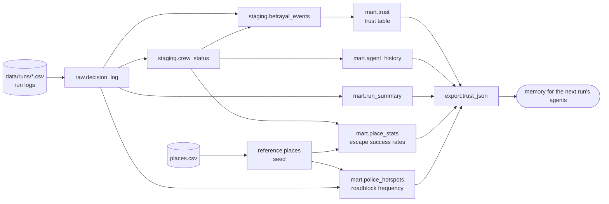

# Transamerica Job

**Four AI agents plan a bank heist on a low-poly 3D map of San Francisco, and every one of them decides for itself.**
After each run, a Bruin pipeline works out who betrayed whom and which escape routes worked. The next crew starts with those memories, so their decisions change over time.


## ▶ Play

| | Link | What you get |
|---|---|---|
| **With the AI crew** | [claude.ai/artifact/31isQgQnJaU9nVwsZ6LteU](https://claude.ai/artifact/31isQgQnJaU9nVwsZ6LteU) | The full game. Open it in Chrome or Edge while signed in to Claude; the agents run on your own Claude account. Pick a character under **Play as** to join the crew yourself. |
| **Demo mode, no sign-in** | [jihyeonkim610.github.io/transamerica-job](https://jihyeonkim610.github.io/transamerica-job/) | The 3D city, characters, cutscenes and decision log, with random decisions instead of AI. |

## The crew

| | Name | Role | Personality |
|---|---|---|---|
|  | **Ruby** | Leader | Calm planner who wants to protect the crew |
|  | **Sky** | Driver | Nervous, but knows every street in San Francisco |
|  | **Sunny** | Hacker | Only cares about money and keeps pushing for a bigger share |
|  | **Mint** | Infiltrator | **Secretly a police informant.** Only Mint knows |

## What it does

- **3D city:** Golden Gate Bridge, Bay Bridge, Transamerica Pyramid, Lombard Street, Fisherman's Wharf, Alcatraz and the Mission District, built from simple shapes in Three.js
- **Agents that decide:** for up to 10 scenes, each agent chooses what to say, what to do, where to go, its escape route and the share of the loot it wants. A narrator agent rolls dice and decides what actually happens
- **Join the crew:** pick a character under **Play as** and decide for them on their turn; the AI crew hears you as that character and reacts
- **A different ending every run:** a hidden twist per run, random world events (fog, traffic, a police helicopter), dice rolls, and the memory of earlier endings
- **Speech bubbles and voices:** every character speaks its lines in its own voice
- **Cutscenes:** arrests, escapes, the betrayal and the heist each pop up as an image (pre-generated with Runware)
- **Decision log:** who decided what and why, saved as CSV
- **Memory and learning:** a Bruin pipeline loads past logs into DuckDB, builds a trust table and escape-route statistics, and hands them to the agents as memory

## How it works

The AI runs on claude.ai; images and memory are prepared on your own computer.

1. Play a run on the claude.ai page
2. Save the decision log as CSV
3. Run `update-trust.ps1` (Bruin: CSV → DuckDB → trust table → `trust.json`)
4. Click **Load trust.json** on the page, and the next crew starts with those memories

- **On claude.ai:** the agents, voices and file saving run on the viewer's own Claude account. No API key is needed.
- **On your computer:** Runware image generation (key in `.env`) and the Bruin pipeline.
- Opening `index.html` locally runs a **demo mode** where the characters move at random, without AI.

## Bruin pipeline: memory and learning

`pipelines/trust` turns run logs into the **memory and knowledge** the agents use in the next run. Bruin runs its 10 assets in dependency order and stores the data in DuckDB.



| Table | What the agents remember |
|---|---|
| `mart.trust` | Everyone: "Your trust in Mint: 22/100 (exposed as a police informant once)" |
| `mart.agent_history` | Each agent: its own record. Mint alone: how many secret texts it has sent the police |
| `mart.place_stats` | Sky, the Driver: success and arrest rates per escape route, so **routes change based on the data** |
| `mart.police_hotspots` | Sky, the Driver: where police roadblocks tend to appear |
| `mart.run_summary` | Everyone: how the last few runs ended |

Every asset has an owner, tags, column descriptions and primary keys, and **94 quality checks** verify the data on every run. For example:
- statuses are one of the five allowed values (`accepted_values`)
- trust scores and rates stay in range (`min`, `max`)
- places and trust pairs are never duplicated (`unique`, custom checks)
- only the informant ever texts the police, and only exits produce escapes (custom checks)

The repository is also connected to Bruin Cloud, where the catalog, lineage and governance scores are visible.

## Trust score rules

Every pair (how much A trusts B) **starts at 70** and moves between 0 and 100 with the events A **could know about**.

| Event | Points |
|---|---|
| Secret text to the police (the crew only knows if the informant was exposed in that run) | −18 |
| Exposed as the police informant | −30 |
| Escaped at the moment a crewmate was arrested | −12 |
| Asked for 35% or more of the loot | −6 |
| Escaped together | +12 |

Secret texts that were never discovered stay in Mint's own memory only.

## Requirements

| What | Used for | Install |
|---|---|---|
| [Node.js](https://nodejs.org) | Local preview server, image generation | From the official site |
| [Bruin CLI](https://getbruin.com/docs) | Trust pipeline | In Git Bash: `curl -LsSf https://getbruin.com/install/cli \| sh` |
| Runware API key | Only to generate new images | Put it in `.env` (see below) |

### Two files that are not in the repository

They hold secrets or local settings, so they are kept out of git.

**`.env`**: only needed to generate new images. Never share or commit this file.
```
RUNWARE_API_KEY=your-key-here
```

**`.bruin.yml`**: needed to run the Bruin pipeline.
```yaml
default_environment: default
environments:
  default:
    connections:
      duckdb:
        - name: "heist-duckdb"
          path: "data/heist.duckdb"
```

## Usage

### Local preview (demo mode)
```powershell
node scripts/serve.mjs
```
Open http://localhost:8124. Demo runs that finish here are saved to `data/demo-runs/`, so they never mix with the real memory.

### Update the memory after a run
1. On the claude.ai page, click **Save log as CSV**. It goes to your Downloads folder.
2. In this folder, run in PowerShell:
   ```powershell
   powershell -ExecutionPolicy Bypass -File .\update-trust.ps1
   ```
   It moves the logs from Downloads into `data/runs/`, runs the Bruin pipeline, and prints the trust table, escape success rates and police hotspots.
3. On the page, click **Load trust.json** next to **Trust from past runs** and pick `trust.json` from this folder.

### Regenerate images (Runware)
```powershell
node scripts/generate-images.mjs                     # only missing images
node scripts/generate-images.mjs --test              # one portrait (Ruby) to check the key
node scripts/generate-images.mjs --only=arrest_sky   # redo one image
node scripts/generate-images.mjs --redo              # redo everything (costs credits)
```

## Project layout

```
index.html                  The whole game page (map, agents, log, voices, cutscenes)
img/portraits/              4 character portraits
img/cutscenes/              19 cutscenes
scripts/serve.mjs           Local preview server
scripts/generate-images.mjs Runware image generation
pipelines/trust/            Bruin pipeline
  assets/reference/         Place list (seed)
  assets/raw/               Load the CSVs into DuckDB
  assets/staging/           Status changes and betrayal events
  assets/mart/              Trust table, agent records, run summaries, escape-route stats, police hotspots
  assets/export/            Write trust.json
update-trust.ps1            Move logs + run the pipeline in one step
trust.json                  The memory file the page reads
data/runs/                  Real run logs (CSVs saved on claude.ai)
data/demo-runs/             Demo run logs
```
